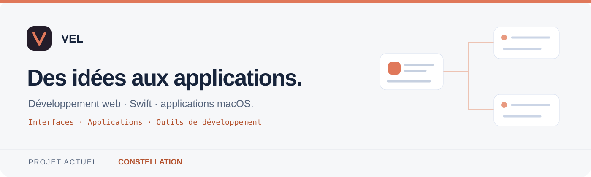

<a href="README.md">English</a> &nbsp; · &nbsp; <a href="README.fr.md">Français</a>

  

<strong>Apple et macOS</strong>  
       

<strong>Outils de développement</strong>  
    

<strong>À approfondir · web et autres langages</strong>  
     

  <a href="#bonjour-moi-cest-vel">À propos</a> ·
  <a href="#projet-principal--constellation">Constellation</a> ·
  <a href="https://github.com/r97sgkjtdh-ops/constellation/releases/latest">Télécharger</a> ·
  <a href="https://github.com/r97sgkjtdh-ops/constellation/issues">Retours</a>

## Bonjour, moi c’est Vel

Je crée des applications et m’intéresse au **développement web**, à **Swift** et aux outils qui rendent le travail des développeurs plus simple. J’aime transformer une idée en une interface claire, puis construire le fonctionnement qui la rend utile.

Mon projet principal est **Constellation**, une application macOS native en Swift. Elle réunit des consoles et organise le travail d’agents de code autour de missions, de tâches et de contrôles.

## Du besoin à l’application

Ce qui m’intéresse dans le développement, c’est le lien entre **le code, l’interface et l’usage réel**. Une fonctionnalité doit être compréhensible à l’écran, utile au quotidien et suffisamment structurée pour pouvoir évoluer.

Je porte une attention particulière aux outils qui donnent de la visibilité sur ce qui se passe : état d’une tâche, résultat d’une commande, progression d’une opération ou erreur à corriger. Cette approche est au cœur de Constellation.

## Ce qui m’intéresse

- **Applications natives** : concevoir des interfaces macOS avec SwiftUI et AppKit, intégrées à leur environnement.
- **Développement web** : créer des interfaces lisibles, une navigation simple et des pages adaptées aux différents écrans.
- **Outils de développement** : relier les terminaux, Git, l’automatisation et le suivi des tâches.
- **Qualité du logiciel** : vérifier le comportement, rendre les erreurs compréhensibles et prévoir la récupération des données.

## Langages et technologies

| Domaine | Technologies et centres d’intérêt |
| :--- | :--- |
| Application actuelle | Swift, SwiftUI, AppKit |
| Web et langages à approfondir | HTML, CSS, JavaScript, TypeScript |
| Scripts et automatisation | Bash ; intérêt pour Python |
| Développement et vérification | Git, GitHub Actions, Swift Package Manager, XCTest |
| Intégrations macOS de Constellation | WebKit, CryptoKit, PDFKit, Charts |

Je choisis les technologies selon le projet et continue à élargir mes connaissances au fil des réalisations.

## Développement web

Le web est un axe que je souhaite approfondir, avec un intérêt pour toute la chaîne qui relie une interface à ses données.

| Sujet | Ce qui m’intéresse |
| :--- | :--- |
| **Interfaces** | Structurer une page, organiser les composants et rendre les actions faciles à comprendre. |
| **Responsive** | Adapter les mises en page au téléphone, à la tablette et à l’ordinateur. |
| **Interactions** | Concevoir des formulaires, des filtres et des retours visuels utiles. |
| **Accessibilité** | Prévoir la navigation au clavier, des libellés explicites et des contrastes lisibles. |
| **API et données** | Comprendre les échanges client-serveur, la validation des entrées et la gestion des erreurs. |
| **Performance** | Limiter les chargements inutiles et garder une interface réactive. |

**HTML et CSS** pour la structure et la présentation ; **JavaScript et TypeScript** pour les interactions et la logique des applications web. Ce sont des pistes de progression, pas une liste de projets déjà livrés.

## Swift et l’écosystème Apple

Avec Constellation, le développement natif constitue la partie la plus concrète de mon portfolio.

- **Swift** pour la logique de l’application, les modèles de données et la gestion des opérations.
- **SwiftUI et AppKit** pour les vues, les fenêtres et l’intégration avec macOS.
- **WebKit** pour le navigateur intégré et **PDFKit** pour les fonctions liées au PDF.
- **Charts** pour représenter les données de consommation.
- **CryptoKit** pour les mécanismes cryptographiques utilisés par les mises à jour.
- **XCTest et GitHub Actions** pour accompagner les changements par des vérifications automatisées.

Ce qui m’attire dans cet environnement : une application qui s’intègre au bureau, des interactions cohérentes et un accès direct aux capacités du système.

## Scripts, outils et autres langages

Je m’intéresse aussi à ce qui entoure l’application : préparer un environnement, lancer une commande, vérifier un résultat ou distribuer une nouvelle version.

- **Bash** : scripts de construction, commandes et automatisation autour du projet.
- **Git** : suivi des changements, branches, worktrees et intégration des contributions.
- **Python** : langage que je souhaite approfondir pour les scripts utilitaires et le traitement de données.
- **TypeScript** : piste de progression pour structurer des applications web avec des types explicites.
- **SQL** : sujet à explorer pour mieux comprendre la modélisation et les requêtes sur des données persistantes.

L’objectif est de choisir un outil adapté au problème, puis de comprendre ses limites et de garder le code lisible.

## Projet principal · Constellation

**Un espace de travail macOS pour coordonner des agents de code et suivre leurs missions.**

- **Coordination** : une mission est répartie en tâches, avec des dépendances et des délégations à des sous-agents.
- **Visibilité** : consoles, carte de mission et états des tâches permettent de suivre l’avancement.
- **Vérification et isolation** : commandes de test, revue et worktrees Git accompagnent le travail et son intégration.

### Ce que l’application réunit

| Fonction | Utilité |
| :--- | :--- |
| **Coordinateur et sous-agents** | Répartir une demande en tâches et suivre les délégations. |
| **Carte de mission** | Visualiser les tâches, leurs relations et leur état. |
| **Consoles intégrées** | Suivre les commandes et les processus dans un même espace. |
| **Worktrees Git** | Isoler le travail avant de réintégrer les contributions. |
| **Contrôles et revue** | Exécuter des vérifications et organiser les corrections. |
| **Suivi de consommation** | Consulter l’activité et les indicateurs disponibles. |
| **Sauvegardes et mises à jour** | Accompagner l’évolution de l’application avec des mécanismes de récupération. |

### Constellation en images

<table>
<tr>
<td width="50%" valign="top"> <strong>Préparer une mission</strong> Définir un objectif et les contrôles à exécuter.</td>
<td width="50%" valign="top"> <strong>Suivre le travail</strong> Visualiser les tâches et leurs relations.</td>
</tr>
<tr>
<td width="50%" valign="top"> <strong>Entrer dans l’application</strong> Un accueil dédié à la connexion.</td>
<td width="50%" valign="top"> <strong>Consulter la consommation</strong> Voir les indicateurs d’utilisation disponibles.</td>
</tr>
</table>

### Les sujets techniques derrière le produit

Construire cet espace de travail fait intervenir plusieurs questions : comment représenter une mission, gérer les dépendances entre tâches, suivre des processus et présenter un échec sans le masquer. L’intégration Git et la persistance ajoutent d’autres contraintes : conserver les contributions, gérer les conflits et prévoir une reprise.

Ce projet réunit ainsi **conception d’interfaces, gestion des processus, orchestration, sauvegardes et tests automatisés**. Les fonctionnalités et les limites de chaque version sont détaillées dans la documentation du projet.

L’application est distribuée via GitHub Releases. Le dépôt public rassemble sa documentation, ses captures et les versions publiées ; le code source est privé.

[Découvrir le projet →](https://github.com/r97sgkjtdh-ops/constellation) · [Télécharger →](https://github.com/r97sgkjtdh-ops/constellation/releases/latest) · [Documentation →](https://github.com/r97sgkjtdh-ops/constellation#readme)

## Ma démarche

- **Partir de l’usage** : comprendre le besoin avant d’ajouter des fonctionnalités.
- **Soigner l’interface** : privilégier la lisibilité, la cohérence et des actions compréhensibles.
- **Vérifier le résultat** : utiliser des tests et des essais concrets, puis documenter les limites connues.
- **Préserver les données** : prévoir des sauvegardes et des procédures de retour arrière.
- **Améliorer progressivement** : corriger, simplifier et faire évoluer le projet à partir des retours.

## Mes priorités de progression

- **Faire évoluer Constellation** à partir des usages et des problèmes rencontrés.
- **Approfondir le développement web**, de l’interface aux échanges avec une API.
- **Renforcer la qualité du code** : responsabilités claires, erreurs explicites et tests utiles.
- **Mieux documenter les projets** avec des exemples, des captures et des instructions reproductibles.
- **Explorer d’autres langages** lorsqu’ils répondent à un besoin concret.

## Ce que je souhaite partager ici

Des applications, leurs évolutions et les choix techniques qui les accompagnent. Pour Constellation, les versions publiées et la documentation sont accessibles sur GitHub. Les autres domaines présentés sur ce profil décrivent mes centres d’intérêt et mes axes de progression.

## Échanger autour du projet

Pour signaler un problème ou proposer une amélioration de Constellation, [ouvre une issue sur le dépôt](https://github.com/r97sgkjtdh-ops/constellation/issues).

---

Vel · Développement web · Swift · Applications macOS

