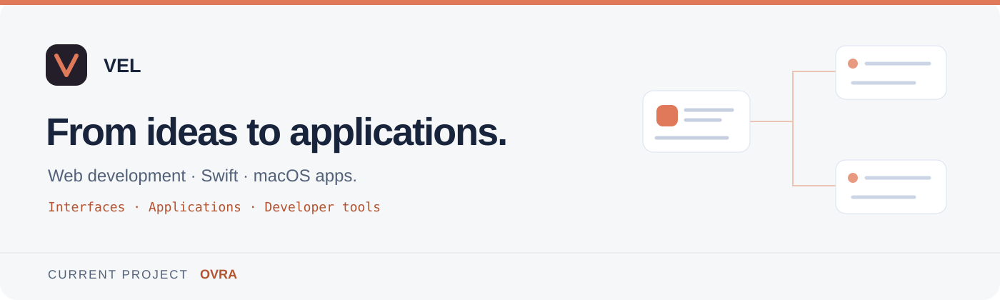

<a href="README.md">English</a> &nbsp; · &nbsp; <a href="README.fr.md">Français</a>

  

<strong>Apple & macOS</strong>  
       

<strong>Development tools</strong>  
    

<strong>Exploring · web & other languages</strong>  
     

  <a href="#hi-im-vel">About</a> ·
  <a href="#featured-project--ovra">Ovra</a> ·
  <a href="#new-project--octo">Octo</a> ·
  <a href="https://vel-portfolio-xi.vercel.app">Portfolio</a> ·
  <a href="https://github.com/r97sgkjtdh-ops/ovra/releases/latest">Download</a> ·
  <a href="https://github.com/r97sgkjtdh-ops/ovra/issues">Feedback</a>

## Hi, I’m Vel

I build applications and explore **web development**, **Swift**, and tools that make developers’ work easier. I enjoy turning an idea into a clear interface, then building the behavior that makes it useful.

My main project is **Ovra**, a native macOS application built with Swift. It brings consoles together and organizes coding agents around missions, tasks, and checks. My newest one is **Octo**, also native and written in Swift: terminals side by side, where several AIs work as a team.

## From a need to an application

What interests me is the connection between **code, interface design, and real-world use**. A feature should make sense on screen, help with an actual task, and remain maintainable as the application evolves.

I pay particular attention to visibility: the state of a task, the result of a command, the progress of an operation, or an error that needs attention. This approach is central to Ovra and Octo.

## Areas of interest

- **Native applications** — macOS interfaces built with SwiftUI and AppKit that feel at home on the desktop.
- **Web development** — readable interfaces, straightforward navigation, and layouts that adapt to different screens.
- **Developer tools** — terminals, Git, automation, and task tracking in a connected workflow.
- **Software quality** — useful checks, understandable errors, and ways to recover data.

## Languages & technologies

| Area | Technologies and interests |
| :--- | :--- |
| Current applications | Swift, SwiftUI, AppKit; SwiftTerm for Octo’s terminals |
| Web | HTML, CSS, JavaScript (my portfolio site); TypeScript to explore |
| Scripting and automation | Bash; an interest in Python |
| Development and verification | Git, GitHub Actions, Swift Package Manager, XCTest |
| Ovra’s macOS integrations | WebKit, CryptoKit, PDFKit, Charts |

I choose technologies around the needs of a project and keep expanding my knowledge through practical work.

## Web development

Web development is an area I want to explore further, from the interface to the data behind it.

| Topic | What interests me |
| :--- | :--- |
| **Interfaces** | Structuring pages, organizing components, and making actions easy to understand. |
| **Responsive layouts** | Adapting an interface to phones, tablets, and desktop screens. |
| **Interactions** | Designing forms, filters, and useful visual feedback. |
| **Accessibility** | Keyboard navigation, clear labels, and readable contrast. |
| **APIs and data** | Client-server communication, input validation, and error handling. |
| **Performance** | Avoiding unnecessary loading and keeping interfaces responsive. |

**HTML and CSS** for structure and presentation; **JavaScript and TypeScript** for interactions and application logic. My first shipped web project is [my portfolio](https://vel-portfolio-xi.vercel.app): a single page in plain HTML, CSS, and JavaScript, with canvas animations and no framework. The rest are learning interests.

## Swift & the Apple ecosystem

Through Ovra and Octo, native development is the most concrete part of my portfolio.

- **Swift** for application logic, data models, and operations.
- **SwiftUI and AppKit** for views, windows, and macOS integration.
- **WebKit** for the integrated browser and **PDFKit** for PDF functionality.
- **Charts** for usage visualizations.
- **CryptoKit** for cryptographic mechanisms used by updates.
- **SwiftTerm** for terminal emulation in Octo.
- **XCTest and GitHub Actions** for automated verification alongside changes.

What draws me to this environment is desktop integration, consistent interactions, and access to the capabilities of the operating system.

## Scripting, tools & other languages

I’m also interested in the work surrounding an application: preparing an environment, running commands, checking results, and distributing a release.

- **Bash** — build scripts, commands, and project automation.
- **Git** — tracking changes, branches, worktrees, and integrating contributions.
- **Python** — a language I want to explore further for utility scripts and data processing.
- **TypeScript** — a learning direction for structuring web applications with explicit types.
- **SQL** — an area to explore for data modeling and querying persistent data.

The goal is to select a suitable tool, understand its limits, and keep the code readable.

## Featured project · Ovra

**A macOS workspace for coordinating coding agents and following their missions.**

- **Coordination** — break a mission into tasks, dependencies, and delegations to sub-agents.
- **Visibility** — follow progress through consoles, a mission map, and task states.
- **Verification and isolation** — use test commands, reviews, and Git worktrees to support execution and integration.

### What the application brings together

| Feature | Purpose |
| :--- | :--- |
| **Coordinator and sub-agents** | Distribute a request across tasks and follow delegations. |
| **Mission map** | Visualize tasks, their relationships, and their state. |
| **Integrated consoles** | Follow commands and processes in one workspace. |
| **Git worktrees** | Isolate work before integrating contributions. |
| **Checks and review** | Run verification commands and organize corrections. |
| **Usage tracking** | Inspect activity and the available indicators. |
| **Backups and updates** | Support application changes with recovery mechanisms. |

### A closer look

<table>
<tr>
<td width="50%" valign="top"> <strong>Plan a mission</strong> Set an objective and the checks to run.</td>
<td width="50%" valign="top"> <strong>Follow the work</strong> See tasks and their relationships.</td>
</tr>
<tr>
<td width="50%" valign="top"> <strong>Get started</strong> A dedicated sign-in experience.</td>
<td width="50%" valign="top"> <strong>Review usage</strong> Inspect the available usage indicators.</td>
</tr>
</table>

### Engineering behind the product

Building this workspace involves several questions: how to represent a mission, manage task dependencies, follow processes, and report a failure clearly. Git integration and persistence add further constraints: retaining contributions, handling conflicts, and planning recovery.

The project brings together **interface design, process management, orchestration, backups, and automated tests**. Features and limitations for each release are described in the project documentation.

The application is distributed through GitHub Releases. The public repository contains documentation, screenshots, and published releases; the source code is private.

[Explore the project →](https://github.com/r97sgkjtdh-ops/ovra) · [Download →](https://github.com/r97sgkjtdh-ops/ovra/releases/latest) · [Documentation →](https://github.com/r97sgkjtdh-ops/ovra#readme)

## New project · Octo

**Terminals side by side, so several AIs can work as a team on a Mac.**

Octo opens up to sixteen terminals in a single window. Each one runs a command-line AI (Claude Code, Codex, Gemini CLI, Aider…) or a plain shell. Octo shows where each terminal stands, tells you when an AI has finished or is waiting for your answer, and gives the AIs a shared command, `t8`, to talk to each other and split the work without stepping on each other.

| Feature | Purpose |
| :--- | :--- |
| **A grid of 1 to 16 terminals** | Each with its own folder, its own AI, and a live state. |
| **The `t8` command** | From its terminal, an AI starts another one, asks it a question, reads its screen, or waits for it to finish. |
| **Team mode** | AIs in the same project reserve files before changing them, send each other messages, and see who is doing what. |
| **Safeguards** | Writing in another terminal’s shell, answering in its place, or changing a sensitive setting needs your approval. |

Octo 2.0 is a native Swift and AppKit application built on SwiftTerm. It is still an alpha, and its code is private for now.

## How I approach development

- **Start with the use case** — understand the need before adding features.
- **Care about the interface** — prioritize readability, consistency, and understandable actions.
- **Verify the result** — use tests and practical checks, then document known limitations.
- **Protect data** — plan backups and recovery procedures.
- **Improve incrementally** — fix, simplify, and evolve the project through feedback.

## What I want to work on next

- **Develop Ovra further** around actual usage and reported problems.
- **Bring Octo to a first stable version.**
- **Explore web development** from interfaces to API communication.
- **Strengthen code quality** with clear responsibilities, explicit errors, and useful tests.
- **Improve documentation** with examples, screenshots, and reproducible instructions.
- **Explore other languages** when they answer a concrete need.

## What you’ll find here

Applications, their evolution, and the technical choices behind them. Ovra’s published releases and documentation are available on GitHub; Octo is still in development. The other areas on this profile describe my interests and learning directions.

## Project feedback

To report a problem or suggest an improvement to Ovra, [open an issue on the project repository](https://github.com/r97sgkjtdh-ops/ovra/issues).

---

Vel · Web development · Swift · macOS applications

