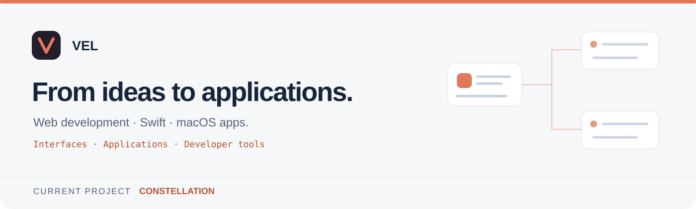

  

  <a href="https://github.com/r97sgkjtdh-ops/constellation">Constellation</a> ·
  <a href="https://github.com/r97sgkjtdh-ops/constellation/releases/latest">Télécharger</a> ·
  <a href="https://github.com/r97sgkjtdh-ops/constellation/issues">Retours</a>

## Bonjour, moi c’est Vel

Je développe des **applications macOS natives en Swift**. Je m’intéresse surtout aux outils de développement : faire travailler plusieurs processus ensemble, garder les données en sécurité et prouver qu’un résultat est correct plutôt que le supposer.

Mon projet principal est **Constellation**, un espace de travail pour piloter des agents de code sur Mac.

## Constellation

**Un tableau macOS qui réunit tes agents de code et coordonne des missions vérifiées.**

Une demande est découpée en tâches par un coordinateur, réalisée par des sous-agents, puis contrôlée par l’application elle-même : elle exécute les commandes de test avant de déclarer quoi que ce soit réussi.

### En images

<table>
  <tr>
    <td width="50%" valign="top">
      
       <b>Accueil</b> · connexion au compte Claude, emblème animé.
    </td>
    <td width="50%" valign="top">
      
       <b>Nouvelle mission</b> · objectif, commandes de contrôle, mode d'isolation.
    </td>
  </tr>
  <tr>
    <td width="50%" valign="top">
      
       <b>Carte de mission</b> · consoles, tâches, sous-tâches et leurs relations.
    </td>
    <td width="50%" valign="top">
      
       <b>Consommation</b> · tokens par jour, par modèle et par projet.
    </td>
  </tr>
</table>

### Sous le capot

| Domaine | Ce que fait le code |
| :--- | :--- |
| **Moteur de missions** | Plan validé (clés, dépendances, détection de cycles), tâches lancées en parallèle quand leurs fichiers ne se recouvrent pas, corrections, revue indépendante, délégation en cascade sous budget. |
| **Isolation Git** | Chaque sous-agent peut travailler dans son propre worktree ; les contributions reviennent sous forme de patchs, intégrés tout ou rien, avec gestion des conflits. |
| **Vrais terminaux** | Consoles PTY (SwiftTerm) : Ctrl-C, applications plein écran, truecolor, 10 000 lignes d’historique. L’état de Claude Code est suivi par ses hooks. |
| **Mises à jour signées** | Archives signées en Ed25519 (CryptoKit), vérification de l’identifiant, de la version et de la signature de code ; installation qui sauvegarde l’ancienne version et les données avant de remplacer quoi que ce soit. |
| **Données** | Enregistrement versionné avec copie précédente, instantanés et migration automatique des anciens formats et emplacements. |
| **Système** | Dictée transcrite sur l’appareil (Speech), navigateur intégré (WebKit), export PDF (PDFKit), graphiques de consommation (Charts). |

### En chiffres

- **33 fichiers Swift**, environ **18 400 lignes** pour l’application et **1 800 lignes de tests**.
- **80 tests XCTest**. Le moteur de missions est testé avec un faux CLI qui simule les agents : aucun appel payant n’est nécessaire pour vérifier le comportement.
- Distribution par **GitHub Releases**, mises à jour intégrées à l’application.

**Disponibilité :** macOS 14 ou plus récent, Apple Silicon. Gratuite à l’usage, sous licence propriétaire : le dépôt public contient la documentation et les versions publiées.

[Découvrir le projet →](https://github.com/r97sgkjtdh-ops/constellation) · [Documentation →](https://github.com/r97sgkjtdh-ops/constellation#readme) · [Versions →](https://github.com/r97sgkjtdh-ops/constellation/releases)

## Outils

| Langages | Frameworks Apple | Outils |
| :--- | :--- | :--- |
| Swift · Bash | SwiftUI · AppKit · CryptoKit · WebKit · Speech · PDFKit · Charts | Swift Package Manager · Git · GitHub CLI · XCTest |

## Ma façon de coder

- **Prouver plutôt que supposer** : un résultat n’est validé que par une commande exécutée, pas par une affirmation.
- **Ne jamais perdre de données** : sauvegarde avant chaque remplacement, et une procédure pour revenir en arrière.
- **Tester sans dépendre du réseau** : des doublures pour les outils externes, et les essais réels gardés pour la fin.
- **Dire ce qui n’est pas vérifié** : les limites connues sont écrites dans la documentation.

## Échanger

Un bug, une idée ou une question sur Constellation ? [Ouvre une issue sur le projet](https://github.com/r97sgkjtdh-ops/constellation/issues/new/choose).

---

Vel · Swift · applications macOS natives

